# 拿什么拯救濒临遗忘的手冢治虫宇宙？

**作者**：[陈子敏](http://www.zhihu.com/people/91949509989e39acc6e55e4216ac260b)

**原文**：http://zhuanlan.zhihu.com/p/47838743

**发布时间**：2018-10-28T01:36:28

**编辑时间**：2019-10-18T13:33:12

赞同 104 · 收藏 46 · 喜欢 7 · 评论 16

近日，游戏公司Compile Heart（国内人称地雷社）公布了一款手机游戏新作《绘师神之绊》的预告片。

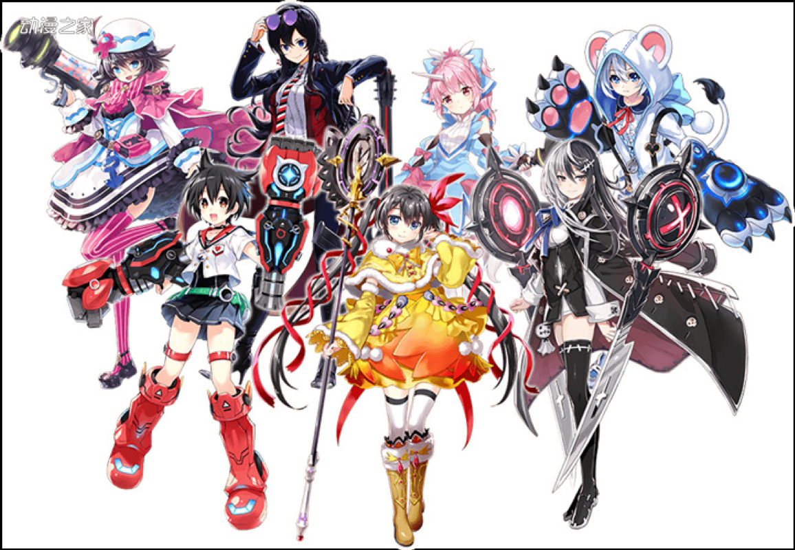

该游戏由手冢Production与地雷社联合推出，将手冢治虫旗下漫画角色一一化身美少女与玩家并肩战斗，计划于2019年上架。目前公布的角色有阿童木（cv：钉宫理惠）、火之鸟（cv：石原夏织）、怪医黑杰克（cv：东山奈央）等经典漫画角色的女体化。

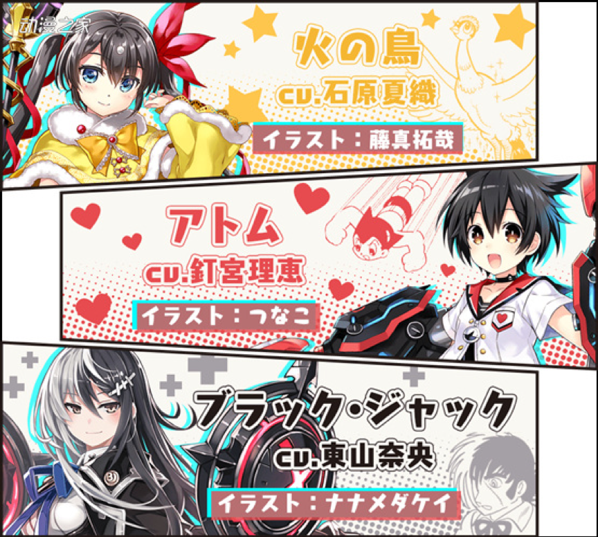

不得不承认，过度泛滥的“娘化”风尚早已使人审美疲劳。该企划一经公布，立即引起大量网友质疑与不满，除了认为将大师经典角色女体化有“渎神”之嫌以外，更指出其人设丝毫没有还原角色特征，缺乏诚意：

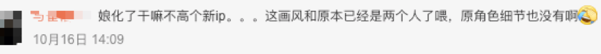

而许多网友更是惊讶于**连黑杰克脸上的缝合痕迹与泾渭分明的肤色都没有好好还原**，仅保留了一些最肤浅的要素：

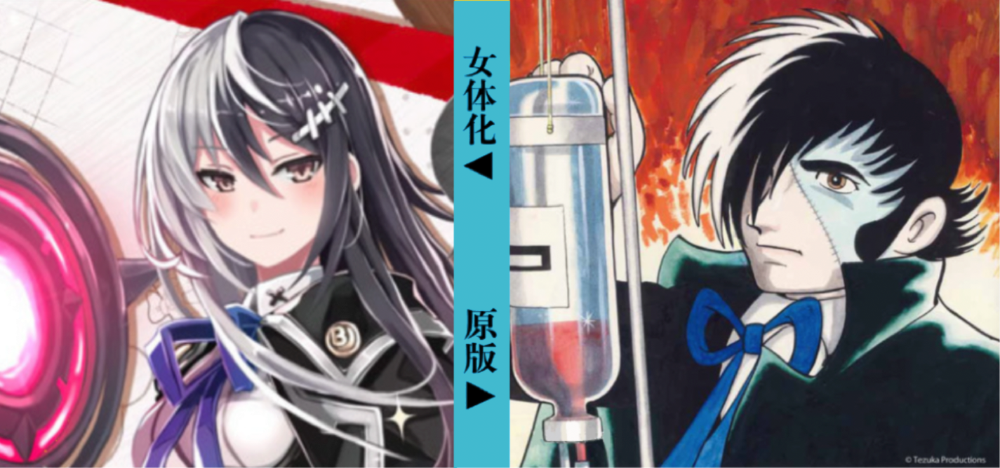

在《怪医黑杰克》原作中《朋友，你在何方》一话，黑男脸上缝合的另一半异色皮肤是在由他小学里的黑人同学所捐献，但这块皮肤在许多海报与封面中被绘制成蓝色。也许这些封面绘制于设定尚未成熟的连载早期，亦有可能是出于艺术需要

仅仅是这些已公布的人设就让人感到没有辨识度，而另外在宣传图中还出现了几位神秘角色，官方甚至并未介绍她们分别来自手冢治虫的哪部作品：

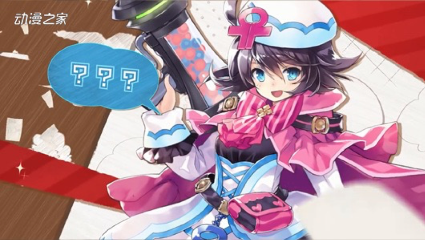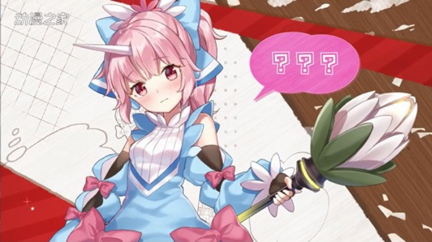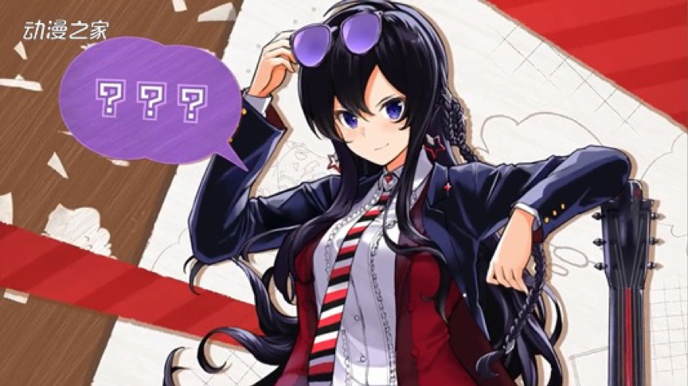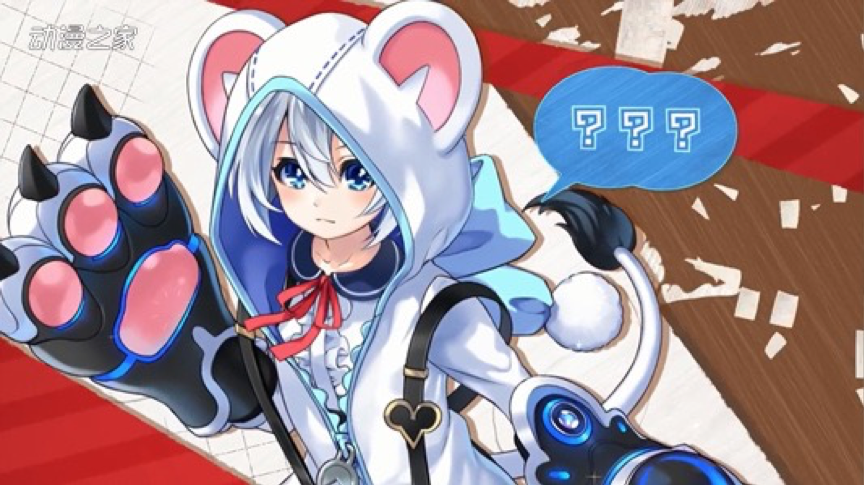

在评价这些美不胜收的美少女人设是否“还原”之前，前提是对于她们的原型是谁我们心知肚明。否则不仅无从比较，连一部手冢作品都没涉猎，却大手一挥道“不还原”、“没诚意”，怕是不免有些贻笑大方。

当然，凭借多年的手冢作品阅读经验，应该可以轻松判断《绘师神之绊》中各个角色的原型。下面我将《绘师神之绊》中的女体化形象与手冢治虫原作角色作一对比，由大家来评判这些“改编”是否具有诚意：

1．**美乐蒙（**メルモ），

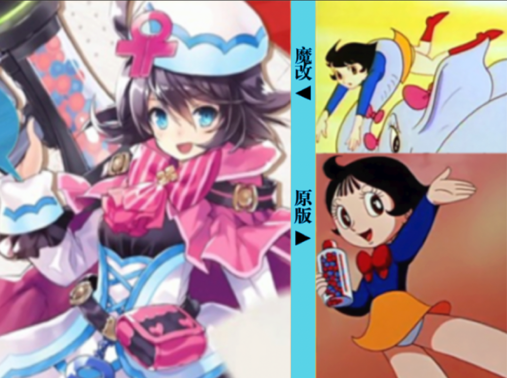

很大程度上的魔改，但保留了发型与蝴蝶结等原有的特征，并且将糖罐头改成糖果枪的设定具有一定创意。

出自作品《神奇糖美乐蒙》，是手冢治虫于1970年推出的一部青春期性教育漫画，并由虫制作改编为电视动画，手冢治虫亲自执导了其中第一话：

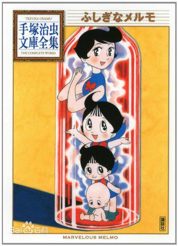

讲谈社手冢治虫文库全集版《神奇糖美乐蒙》封面

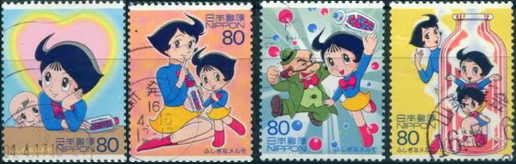

日本邮便曾推出美乐蒙纪念邮票。美乐蒙是1970年代日本最受欢迎的动画角色之一

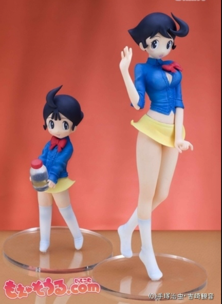

吉崎观音设计的美乐蒙手办，于2008年推出。

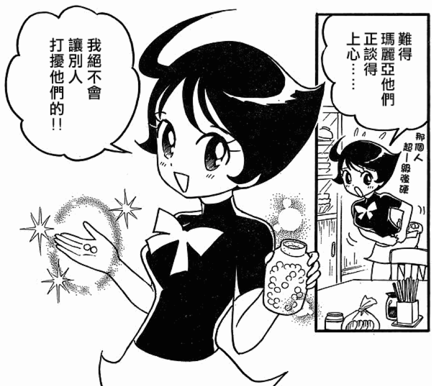

漫画家福山けいこ笔下的美乐蒙

2.**尤尼克**（ユニコ），

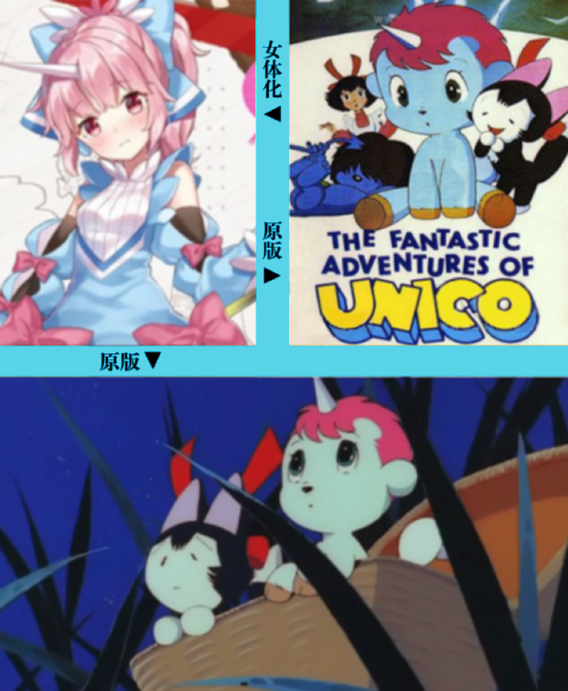

粉色头发、白色独角、通体青色，这也许是《绘师神之绊》几个人设中特征最为明显、最容易识别的一位手冢角色。该作剧场动画曾在中国台湾电视节目《三百六十五夜故事》中播出，并为两岸观众所熟知

出自作品《小白角》（台译《独角小福星》）是手冢治虫1976年连载于三丽鸥旗下少女漫画杂志《LYRICA》的作品，于1981年改编成上下两集剧场版动画：

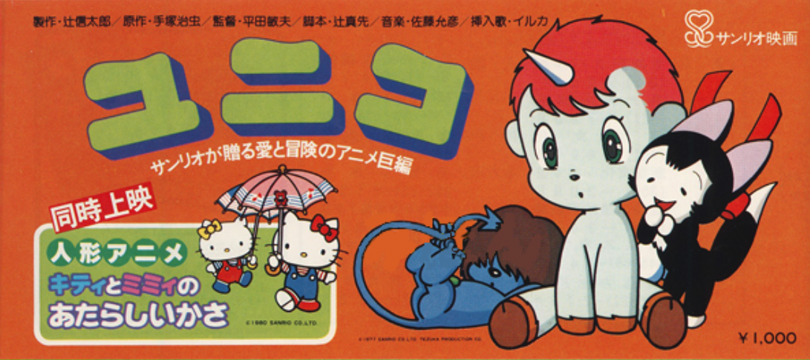

三丽鸥发行的《小白角》剧场版电影票，与《HelloKitty》最初的25分钟短片同时上映。《小白角》与《HELLOKITTY》的企划几乎同时开始进行，都是三丽鸥1970年代后期的品牌战略。

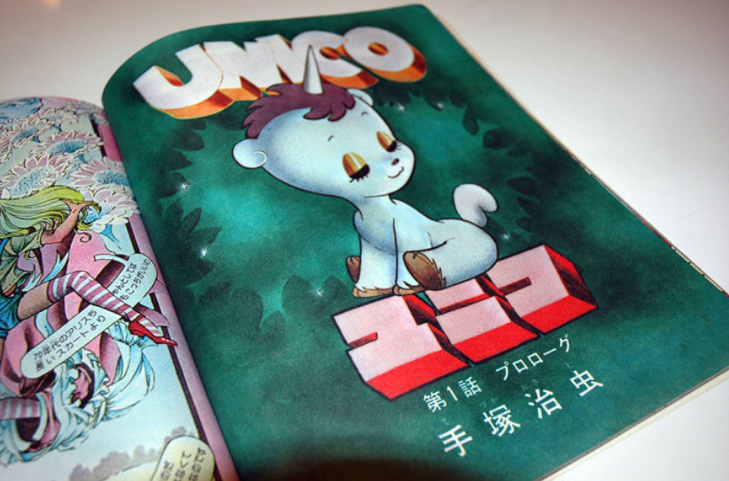

1976年11月连载于《LYRICA》创刊号的《小白角》第一话彩色封面。

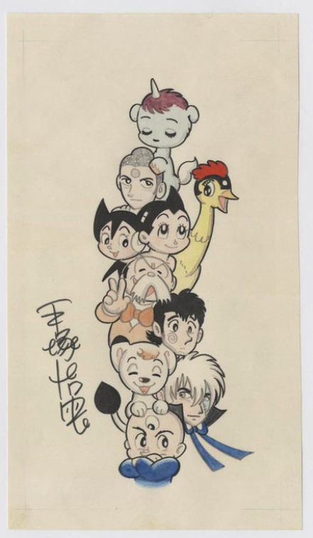

手冢治虫绘制的1977年贺年卡，最上方即为尤尼克。尤尼克是手冢治虫所有创作中最后一个诞生的家喻户晓的漫画形象。

3.**雷欧**（レオ），

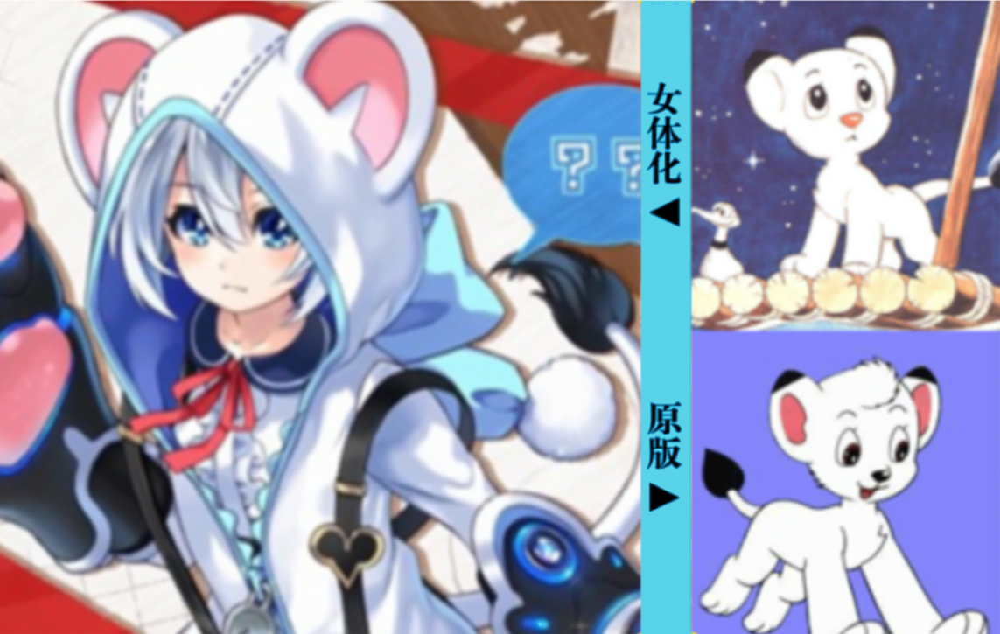

可以看到，部分特征并没有被完全还原，除了白色、兽耳的设定以外，很难看出这是一个手冢角色。

出自作品《森林大帝》，1950年于学童社漫画杂志《漫画少年》连载。于1965年改编为电视动画，是日本第一部彩色电视动画。该动画曾引进中国大陆，于1980年在中央电视台播出，是我国引进的第一部外国彩色电视动画：

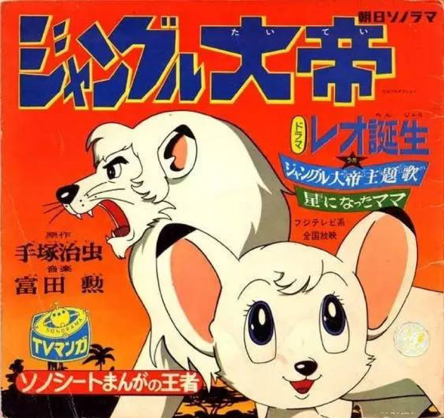

由富田勋大师配乐的1965版电视动画《森林大帝》原声唱片封面。1967年，《森林大帝》剧场版在威尼斯电影节斩获圣马克银狮奖

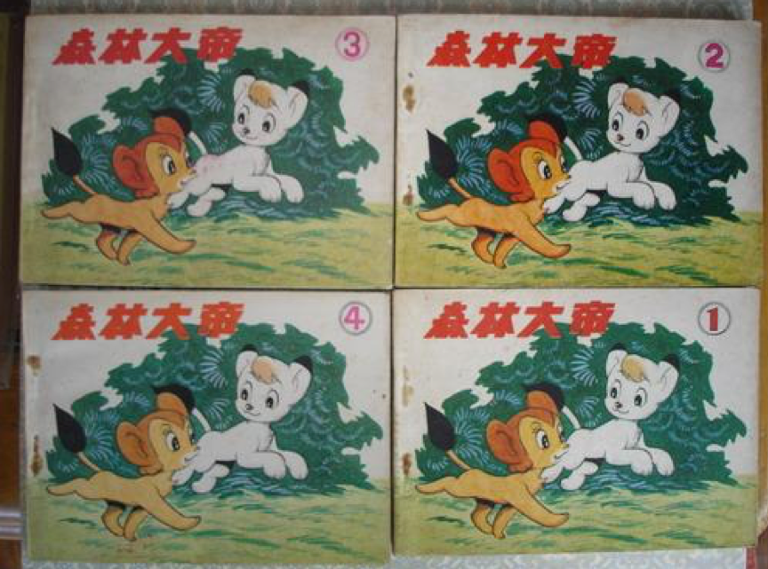

中国大陆于1980年与电视动画版同时正版引进的《森林大帝》“小人书”， 在国内一度风靡。其由手冢治虫本人亲自修改编订为横开本，并免除了中国方面的版税费

4.**洛克**（ロック），

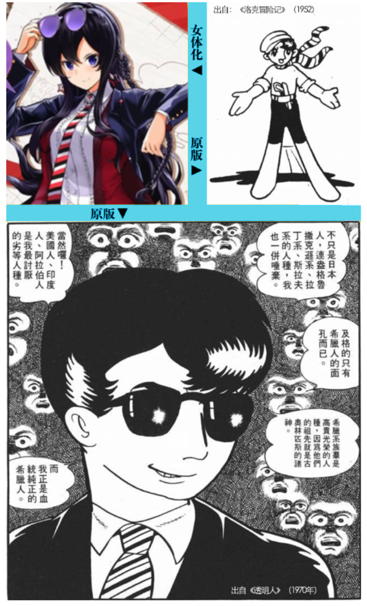

这可能是《绘师神之绊》几个人设中最难以判断的一个，可以说毫无还原度可言，但我们还是能从领带花色与墨镜这仅有的两个特征来判断其原型。早在1952年的《洛克冒险记》中，富于辨识度的条纹领带就已成为洛克的标配

洛克，又名间久部绿郎，首登场于《洛克冒险记》（1952年），是手冢治虫宇宙下经典反派明星，擅长变装、反串以进行作案犯罪活动。常年在各种作品中担任或客串恶役，如《狼人传说》（1966）、《火之鸟·未来篇》（1967）、《透明人》（1970）等。洛克是手冢治虫作品中最重要的固定出场角色之一，拥有频繁的出场率以及极高的人气，但在他第一次登场并以他为主角的《洛克冒险记》中只是担当正派少年角色，他那与外貌迥异的叛逆、阴险、残忍、疯狂却充满魅力的个性并未完全成型。  
洛克善于利用他人特异能力进行犯罪，并且作案手段残忍而无情。他的这种特性也成为了《M·W》中的结城美知夫的原型。偶尔洛克会流露真情、并且透露出身世的悲惨与无奈，在《狼人传说》中，他保护了他童年最好的朋友。他在《怪医黑杰克》中也曾作为黑杰克的童年挚友登场，并在最后因误解遂被黑杰克出卖给警察而判死刑。

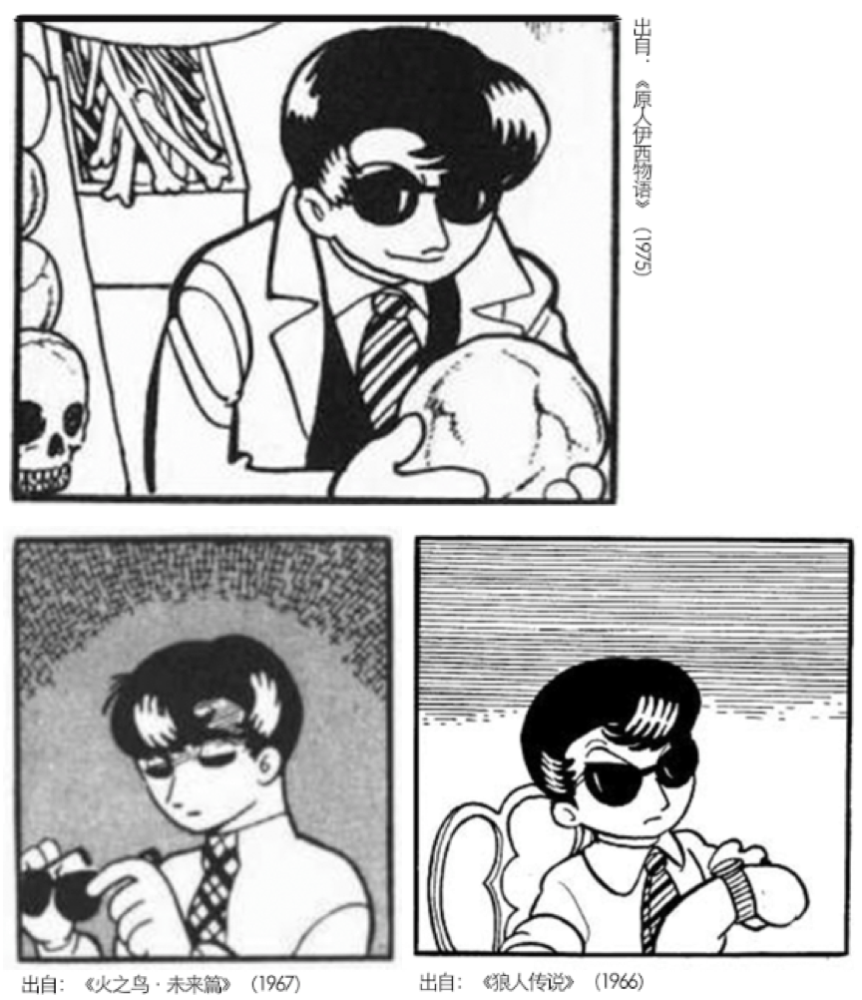

西装、墨镜与条纹领带，洛克在60年代之后所形成的固定标准造型

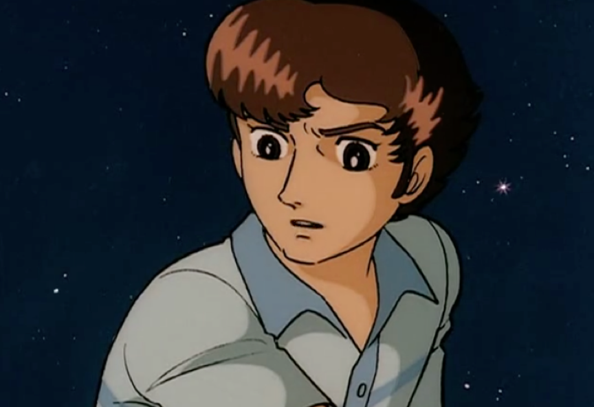

洛克在昭和系手冢动画中唯一一次担任男主人公，以全彩形式亮相。出自1979年在日本电视台《24小时特别节目：爱心拯救地球》中放送的电视剧场版动画《海底超特急号》

从上面的对比来看，我们大概可以做一评价：**完全没有走心的设计。**虽然有其创意之处，但与原作已无甚关联，最重要的一点是：**要素过少**。

面对《绘师神之绊》所公布的苍白无力的预告片，网友所发出的质疑与不满完全合理。如果与原作关系不大的话，那又为何要借手冢治虫的名义推出呢?我们当然可以猜想手冢Production的本意：在手冢治虫诞辰90周年之际，希望借手游这一流行媒介以推广手冢治虫作品与文化，重新掀起手冢作品的热潮。但从已公布的预告片与人设来看，实在离题太远，失去了推广手冢作品的价值。

在手冢治虫90周年诞辰的众多纪念企划中，已经公布的即将在2019年一月季度推出的番剧《多罗罗》新版就足以令手冢漫迷欢呼雀跃，而接着推出《绘师神之绊》就更可谓双喜临门，但倘若可以在人设方面更加用心、还原，想必也不至于被广大网友如此批判。至少在手冢治虫诞辰90周年纪念企划里，能够面向年轻群体中推出一款推广手冢治虫文化的手游，绝非一件坏事。

然而，除了对游戏中新角色形象改编质量的合理质疑外，所谓 “不尊重“、“消费过世大师”甚至是“渎神”的指控则未免显得有些矫揉造作。

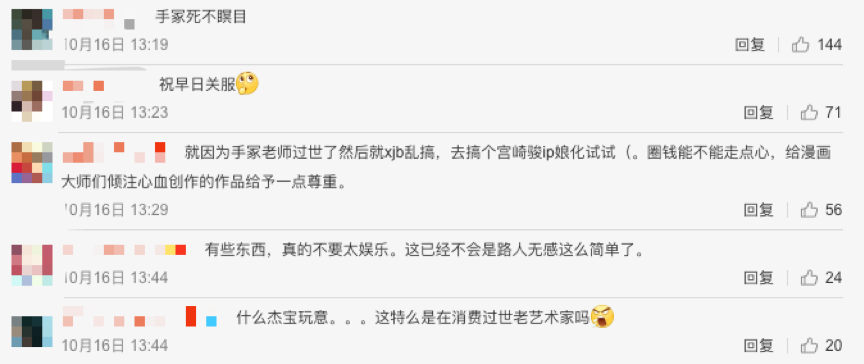

也许在许多人的认识中，手冢治虫是一尊供奉在神坛中不苟言笑的偶像，而他的作品则是象牙塔中不可亵玩的文艺经典，其实不然。联系到近几个月来社会各界对于《王者荣耀》中“篡改历史人物”的批评来看，《绘师神之绊》中“篡改”的严重程度恐怕只能是小巫见大巫。然而抛开《王者荣耀》不谈，就连手冢治虫自己，也曾制作出神话传说乱炖《一千零一夜物语》（1969）， 更有如《克里奥巴特拉计划》（1970）这样重构历史故事的疯狂杰作：

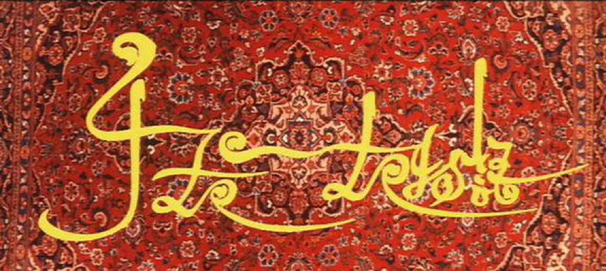

《一千零一夜物语》（1969），由山本映一执导、手冢治虫担任“总指挥”，将众多著名阿拉伯民间故事杂糅混合在一起，结合跨媒介手段，并加入隐晦的意识流性描写，是当时极为先锋的实验作品

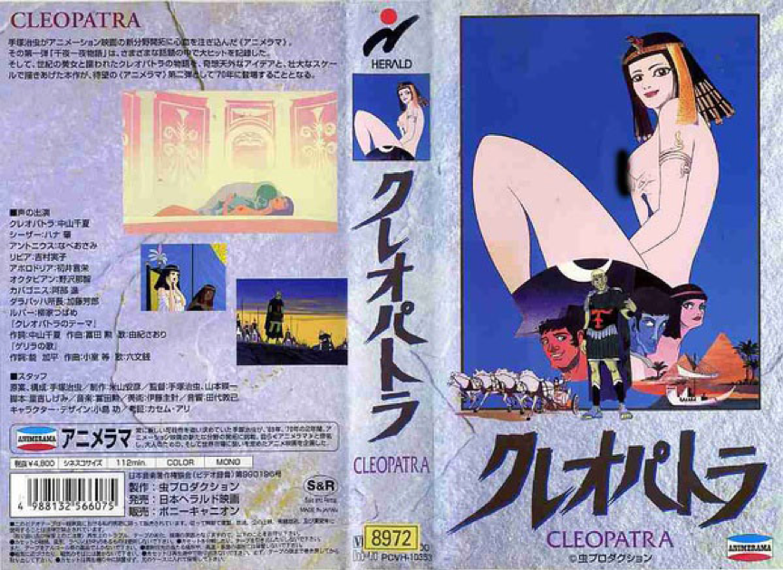

《克里奥巴特拉计划》（1970）由手冢治虫与山本映一合导，将“埃及艳后”的故事重新予以戏谑的解构，影片中以近乎疯狂的勇敢，结合特摄技术、舞蹈、能剧、现代主义艺术等风格以及大量戏仿各个流派艺术作品，造成了一次堪称不朽的形式大狂欢。其中，以日本能剧形式再现凯撒被刺一幕最为经典。

至于认为“娘化”有辱大师一世英名的意味，就更显得假正经了。要知道，漫画史上第一个拥有性转换设定的主人公就出自于手冢治虫于1949年创作的《大都会》：

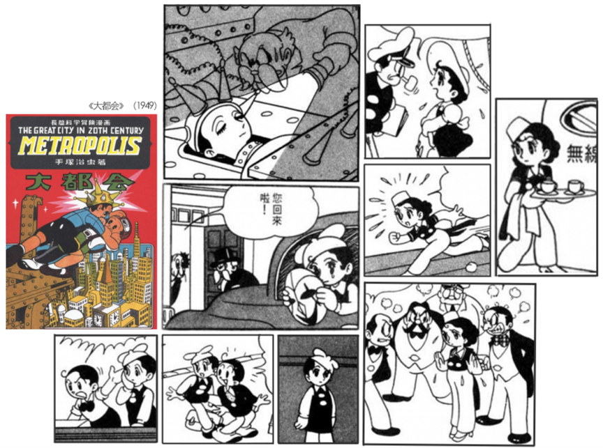

《大都会》（1949）中的米奇，是漫画史上第一个性转角色

在最近的推特话题影响下，有推特网友翻出手冢治虫也曾以女体化的手法描绘卵细胞与精子的结合：

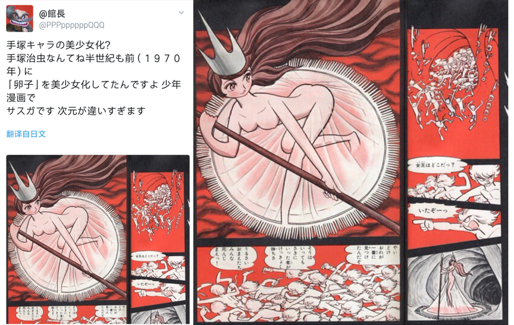

出自《阿波罗之歌》（1970），是手冢治虫为阐述“性与生命” 主题所创作的青春性教育漫画。因六十年代末学潮与暴力运动的影响，使这部作品蒙上了阴暗的基调。

而在手冢治虫的遗作《新浮士德》（1989）中，恶魔梅菲斯特被设计成一位年轻貌美的女子：

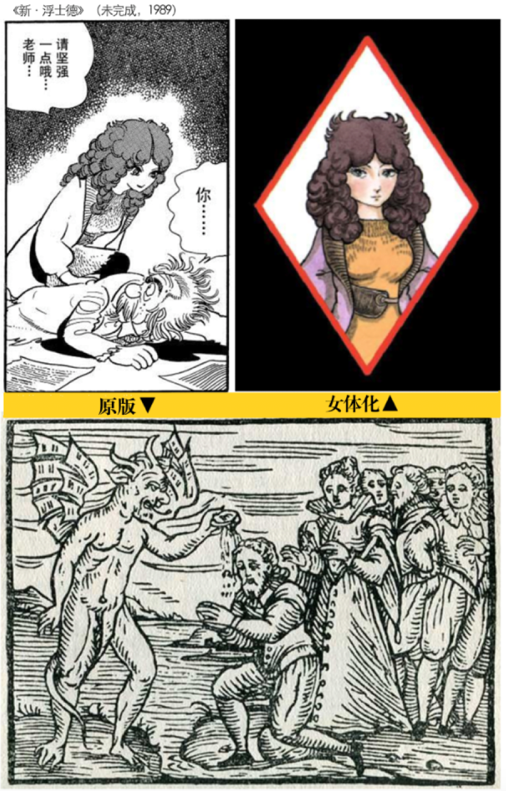

《新·浮士德》（1989）是手冢治虫最后的作品。未能完成便遗憾谢世，自第二卷后半段开始仅留下了大量的铅笔草稿

更不必讲2014年长女手冢留美子在手冢治虫的抽屉中发现许多情色风格的动物女体化插画草稿，“女体化”对于手冢治虫而言根本是家常便饭：

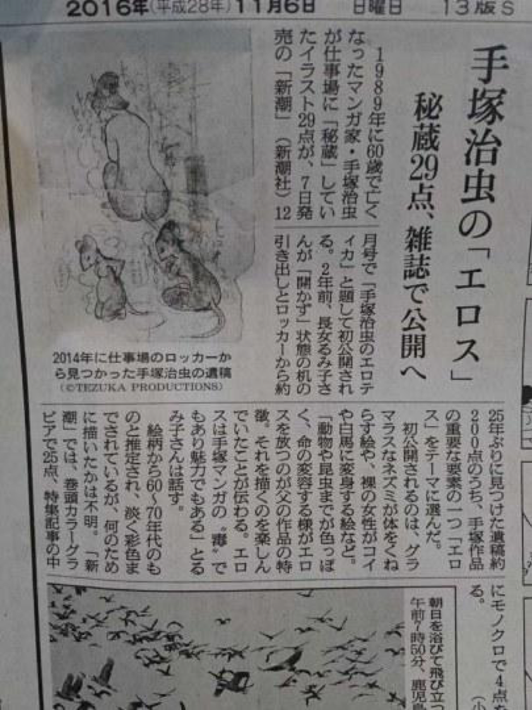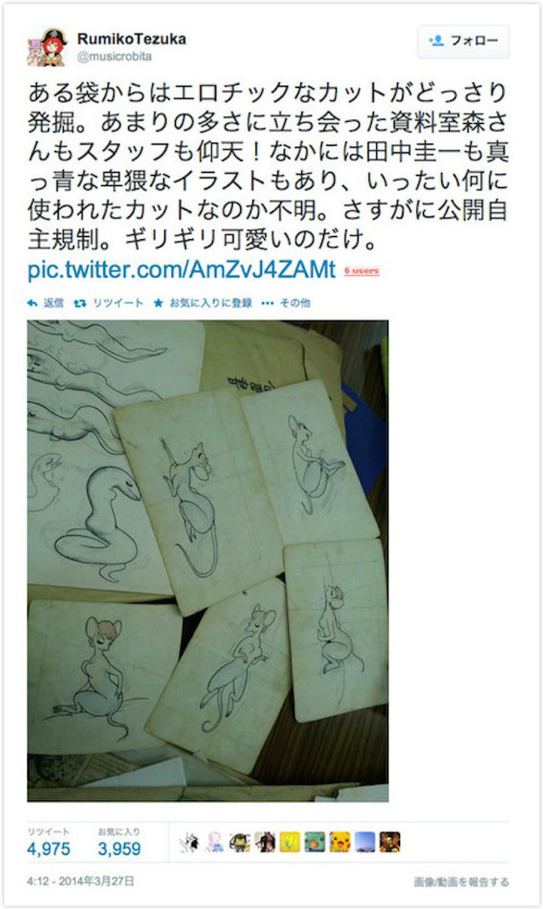

手冢治虫的Furry情结相当知名。事实上在50~60年代的一些作品中有证据表明手冢治虫有可能是当今Furry控潮流的源头之一

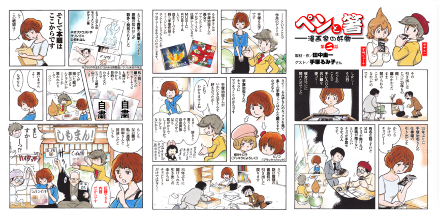

漫画家田中圭一与手冢留美子合作的漫画中也提及此事

我猜想倘若手冢治虫在世，看到自己笔下的角色被娘化，也许并不会像微博网友所想象的那样火冒三丈怒不可遏，而更有可能是这样一幅情景：激动地从画师手里抢过笔来，不甘心地说道：“你这种我也能画！”，然后一边埋头画出更色气的美少女来。

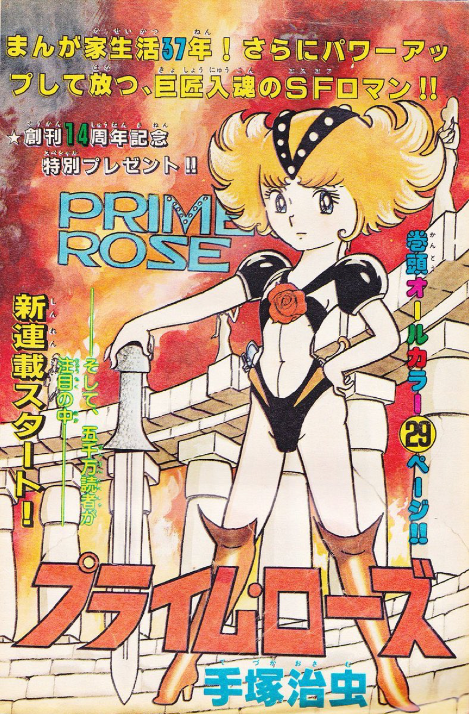

《霹雳玫瑰》（1981）正是手冢这种不服输性格的体现，在80年代初以吾妻日出夫为首的萌系洛丽塔漫画潮流影响下，手冢治虫也不甘示弱作出回应。

即便上面这些例子并不全部足以说明什么，但我们至少知道手冢治虫并非一个不苟言笑的教条主义者——而面对手冢治虫所留下的文化遗产，我们大可不必假作正经、面无表情将其推进象牙塔，相反，它们有无限的可能性。

于是我们又回到了这个老大难问题：该如何看待对历史与经典作品的重构与改编？

数月前，《王者荣耀》被新华社批为“不尊重历史”、“荆轲变成了手持奇怪兵刃的美女刺客，刘备变成了肩抗火枪身穿风衣的黑帮教父”、“对缺少历史知识的少年儿童来说很容易产生迷惑”……如此种种，让人不禁感到中国媒体一向在专业领域的大是大非上过度宽容，却跑去大众娱乐领域钻牛角尖。虽然《王者荣耀》将历史人物与传说典故等元素强行生搬硬套的手法并不高明，但也只是借用了历史中的元素与典故来做游戏英雄，其本身并不蓄意篡改历史，性质不至于到达“亵渎历史”的政治高度。对于专业的历史学者而言，在论文中旁征博引，那么实事求是、尊重历史自然是要务，而在我们草民而言，顶多只能保证不蓄意变天抹黑历史……除了教科书以外，在大多数时候，我们的日常生活甚至都难以跟“历史”沾上几次边，又何谈“尊重历史”这么大的题目呢？而教科书里的内容其吸引力之虚弱自不待言，甚至极而言之，孩子们若不是因为《王者荣耀》，恐怕也不会对“荆轲”与“刘备”抱什么兴趣吧？由于大众无法参与到严谨的研究活动当中，而让这些历史文化名人以时尚新颖的方式重回大众视野中，恐怕也比教科书中枯燥乏味的文字要更有吸引力的多。

**如果“尊重”就是将历史一律当作“雷池”而不敢越之半步，那么也许遗忘就是对历史最好以及最彻底的“尊重”。**

**杀死一种文化最高明的方法就是将其捧上神坛敬而远之**，手冢治虫的作品也不例外。这并不是说为了使手冢治虫的作品能够流传，要我们无条件支持《绘师神之绊》这样的魔改，而是说在今后面对更多对手冢治虫ip的改编与借用，大家不必抱着过于敏感的态度。相反，手冢治虫的创作之伟大之天才，就在于他的作品在任何时候都具有鲜活的生命力，而从不惧于流于娱乐化、大众化。从2015年的《青年黑杰克》、2017年的《阿童木的起源》，到明年一月即将推出的新番《多罗罗》，手冢Production在近年来为推广手冢治虫品牌所做的努力有目共睹，《绘师神之绊》这样的ip改编作品不是第一个，相信也不会是最后一个。

毫无疑问，在**那种对待手冢治虫只讲些空泛肤浅的赞美辞藻却对手冢作品毫不涉猎的风尚之下，手冢治虫与手冢治虫的漫画正在逐渐被人遗忘**。倘若90周年诞辰的各种纪念活动能稍微将手冢作品从象牙塔中抢救出来、重新回到大家的讨论话题中，那可真是全世界人民的福气了。希望22世纪的人们也会依然爱读手冢漫画吧。

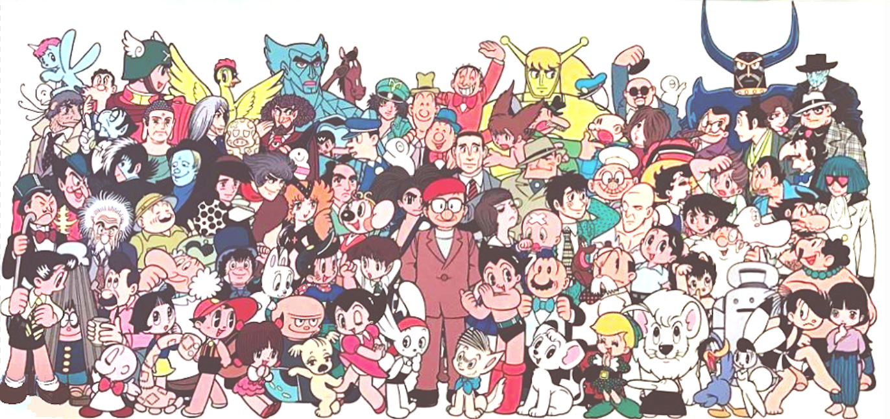

——写在手冢治虫90周年诞辰前夕   
2018.10.22   
*原标题：“拿什么拯救濒临灭绝的手冢宇宙？”*

---

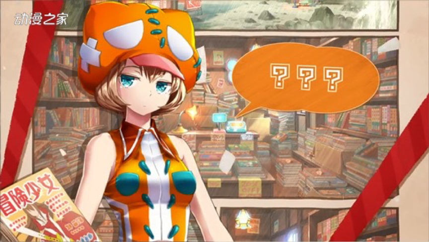

だれ？
