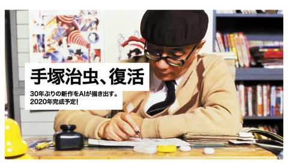

# “手塚治虫新作漫画”创作企划“TEZUKA2020”发表。东芝MEMORY在变更社名为KIOXIA之际，推出了名为“世界

**作者**：[陈子敏](https://www.zhihu.com/people/91949509989e39acc6e55e4216ac260b)

**原文**：https://www.zhihu.com/pin/1162614061576671232

**发布时间**：2019-10-02T06:26:32

赞同 4 · 收藏 0 · 喜欢 0 · 评论 0

“手塚治虫新作漫画”创作企划“TEZUKA2020”发表。东芝MEMORY在变更社名为KIOXIA之际，推出了名为“世界新记忆”的企划，作为企划第1弹，将使用KIOXIA高速大容量的存储以及AI技术，分析数据化的手塚治虫作品，目标是创作出时隔30年的“手塚治虫新作漫画”。该新作漫画预计将于2020年2月与大家见面

