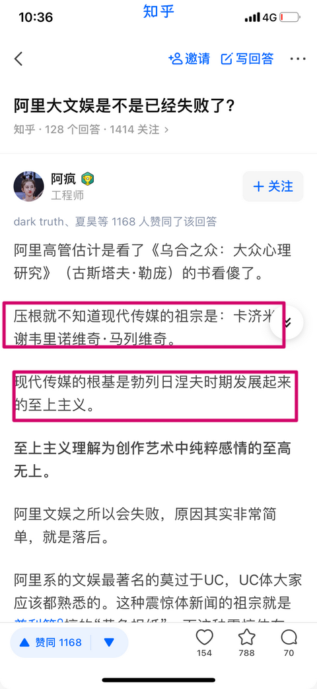

# 咱就问这是啥啊？1915年“至上主义”发展起来的时候勃列日涅夫9岁、马列维奇也不知道什么时候成了“现代传媒的祖宗”，平行

**作者**：[陈子敏](https://www.zhihu.com/people/91949509989e39acc6e55e4216ac260b)

**原文**：https://www.zhihu.com/pin/1477416408246448128

**发布时间**：2022-02-16T22:58:40

赞同 8 · 收藏 0 · 喜欢 2 · 评论 0

咱就问这是啥啊？1915年“至上主义”发展起来的时候勃列日涅夫9岁、马列维奇也不知道什么时候成了“现代传媒的祖宗”，平行宇宙是吧？

