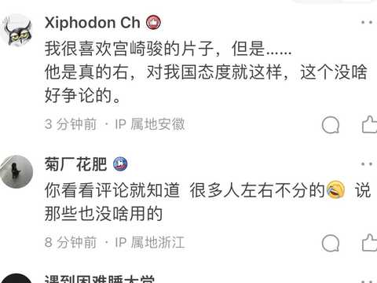

# 宫崎骏为什么讨厌手冢治虫? 乐了这种粪回答都能拿1.1k赞，知乎用户是都没有阅读能力吗？《风之谷》《幽灵公主》《哈尔的移

**作者**：[陈子敏](https://www.zhihu.com/people/91949509989e39acc6e55e4216ac260b)

**原文**：https://www.zhihu.com/pin/1601166332317343744

**发布时间**：2023-01-24T10:36:41

赞同 7 · 收藏 0 · 喜欢 7 · 评论 0

[宫崎骏为什么讨厌手冢治虫?](https://www.zhihu.com/question/316572335/answer/2856182596)   
乐了这种粪回答都能拿1.1k赞，知乎用户是都没有阅读能力吗？《风之谷》《幽灵公主》《哈尔的移动城堡》都成“二战背景创作”了，还能把《虞美人盛开的山坡》说成宫崎骏作品，搁这指点江山批发帽子前先把智力发育好行吧，评论区这还煞有介事帮腔呢，但凡能上网百度一下也不至于这么蠢啊。  
  
评论区：“我很喜欢宫崎骏的片子，但是…他是真的右”  
  
你看过个几把“宫崎骏的片子”，搁这装熟呢，真就原地变身宫崎骏老粉是吧😅

