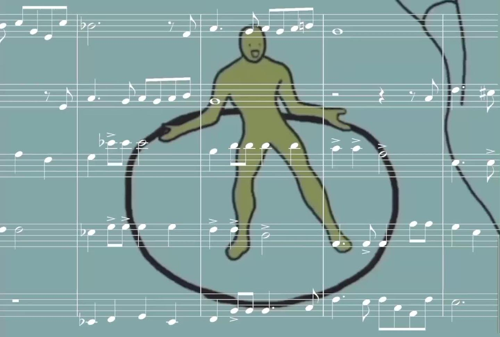

# 巴洛克风格《两只老虎爱跳舞》

**作者**：[陈子敏](https://www.zhihu.com/people/91949509989e39acc6e55e4216ac260b)

**原文**：https://www.zhihu.com/zvideo/1355601759059046400

**发布时间**：2021-03-17T19:36:30

赞同 23 · 收藏 4 · 喜欢 7 · 评论 11

以“两只老虎爱跳舞”为材料展开写作的一个复调风格铜管五重奏，因为结构与对位都并不严谨所以美其名曰“小赋格（Fughetta）”好了。这次所用的编制并不像传统的铜管五重奏而是只有一把小号并加入了一把上低音号，但替换成传统编制时对应声部也可以正常演奏。
可能是我整的最快的一个活~编曲加剪辑一共只花了两天半时间，大部分时间是用在摸鱼上了w。
为避免患有光敏性癫痫的人群的安全隐患，降低了视频中闪烁画面的亮度与对比度。

[视频](videos/001.mp4)
